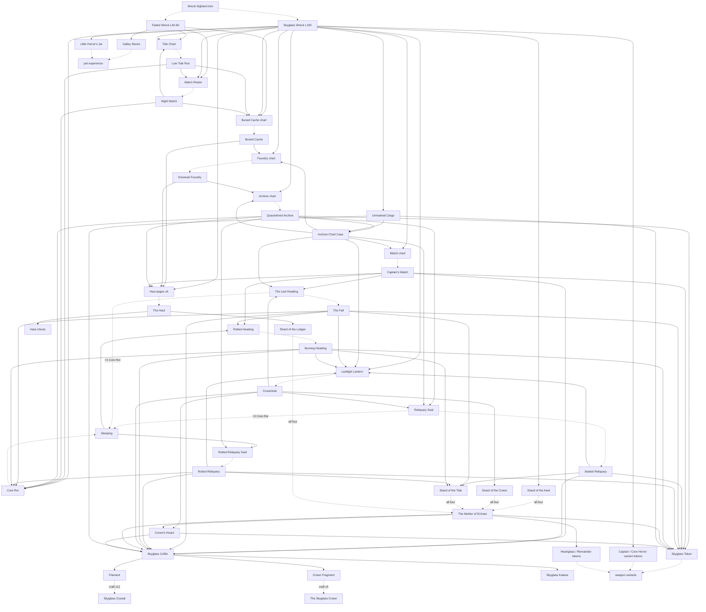

# Skyglass event map: the event as built

**Status:** reference evidence for `docs/design/EVENT_STRUCTURE.md` (RUL-2026-11-05-116). Documentation only; zero live requests.
**Date:** 2026-11-05. **Repository baseline:** `perseverance484/tnr-tools` main at `6289a3e1`.

**This file is a derived map, not an owner.** Every number below is copied from its owner and cited. Where this map and an
owner disagree, the owner wins (`docs/00_INDEX.md` precedence: "Generated file vs prose restating it"; a fresh capture beats
any doc). The owners are:

| Owns | File |
|---|---|
| Caches, picks, chart ladder, Wreck drops, skins, pet | `docs/design/SKYGLASS_LOOT_TABLES.md` (and the rulings it cites) |
| The Haul run shape and payout points | `docs/design/SKYGLASS_THE_HAUL.md` |
| Chart-run picks and ending drops as built | `push/skyglass_charts.gen.py` (`PICK`, `COMMON_END`, `EPIC_END`, `TAINTED_END`, `ENDING`) |
| Rare-run go-live drops | `push/skyglass_update.gen.py` (`PAGE_RARE_ENDING`, `HUNT_VARIANT`) |
| Uber shards | `push/skyglass_uber_economy.gen.py` (`RATES`, `DROPS_TABLE`, `TRADEABLE_TOKENS`) |
| Uber entry and rewards | `push/mother_of_echoes.gen.py` (`PICK`, `TOKEN_PCT`, `REWARD_EXP`, `REWARD_MONEY`) |
| Story | `docs/design/SKYGLASS_STORY_BIBLE.md`; text of record `docs/design/SKYGLASS_TEXT.md` |
| Decisions and history | `docs/RULINGS.md` (RUL-2026-10-23-003 onward) |

**Evidence tier.** The rates are **owner-recorded** (doc or generator) unless marked. No live capture was re-read for this
map; the Wreck's clear rows were set by the director in the dungeon editor (RUL-2026-10-31-089, -087, RUL-2026-11-02-107)
and are not in any committed capture. Tradeability is marked **ruled** (a ruling or generator says so) or **unverified**
(no ruling and no capture found).

## 1. Content nodes

Tier names follow RUL-2026-10-29-058: item rarity Common / Rare / Epic / Legendary; chart tiers Common (Tide, Roster),
Rare (Buried Cache, Foundry, Archive, Watch), Epic (Reliquary Seal, Last Heading), Legendary (tainted, Lantern, Haul pages).

| # | Node | Kind | Entry cost | Limits | Pays (rates per clear unless stated) |
|---|---|---|---|---|---|
| N0 | **Wreck Sighted** | intro quest (push/348) | none | once | points the player at the Wreck: location, three-player rule (RUL-2026-10-31-072 item 8, F07) |
| N1 | **Faded Skyglass Wreck** | party dungeon, level 40-60 tuning, sector 210 16/6 | none; exactly 3 players | repeatable; 1 h run | 25,000 ryo + 500 exp; Tide Chart 35%, Watch Roster 25%, Buried Cache chart 15%, Galley Stores 20% (RUL-2026-10-31-089: editor values, superseding loot tables §2's 25/15/5/10) |
| N2 | **Skyglass Wreck** (endgame) | party dungeon, L100, sector 210 15/6 | none; exactly 3 players | repeatable; 1 h run | 50,000 ryo + 1,000 exp (RUL-089); Unmarked Cargo 10%; Buried Cache chart 20%, Foundry 12%, Archive 6%, Watch 6%, Tide 15%, Roster 10%; Lastlight Lantern 3%; Sealed Treasury 3%; Core Rot 15%; each Haul page 3% (RUL-087); Shard of the Keel 15% (RUL-2026-11-02-107); Little Horror's Jar 5% once per player; Captain and Core Horror variant tokens 5% each, once per player (RUL-2026-10-30-060 item 9) |
| N3 | **The Low Tide Run** | Common chart run (battlepyramid, isolated, scaled to player) | Tide Chart | 100 lifetime attempts (engine; see §6 G7) | pick 1 of Medicine Inro / Galley Stores / Watch Roster; Buried Cache chart 10%; Core Rot 15%; ladder step I |
| N4 | **The Night Watch** | Common chart run, press-on room (Second Watch) | Watch Roster | as N3 | pick 1 of Inro / Galley Stores / Tide Chart; Buried Cache chart 10%; Core Rot 15%; ladder II (III if the room is won) |
| N5 | **The Buried Cache** | Rare chart run (scaled, F02 fix) | Chart of the Buried Cache | as N3 | pick 1 of Inro / Galley Stores / Foundry chart; Foundry chart 15%; each Haul page 1.5% |
| N6 | **The Drowned Foundry** | Rare chart run | Chart of the Drowned Foundry | as N3 | pick 1 of Elemental Tool Pouch / Inro / Galley Stores; Archive chart 10%; Haul pages 1.5% each; Warden's Forge-Fists 1%; ladder V |
| N7 | **The Quarantined Archive** | Rare chart run; clean or alarm route; **break the seal** choice | Chart of the Quarantined Archive | as N3 | pick 1 of Archive Chart Case / Sage's Strongbox / Skyglass Token; Reliquary Seal 25%; Rotted Reliquary Seal 1%; Haul pages 1.5% each; Sealwright's Seal 1%; break the seal: an extra echo fight, Core Rot ×2 guaranteed; ladder V clean / III alarm |
| N8 | **The Captain's Watch** | Rare chart run; terms choice; press-on room (the dawn watch) | Chart of the Captain's Watch | as N3 | pick 1 of Skyglass Coffer / Captain's Purse 1,000,000 ryo / Skyglass Token; The Last Heading 25% (45% if the room is won, RUL-2026-10-31-064 item 2); Rotted Heading 1%; Haul pages 1.5% each; Wayfinder's Heading 1%; ladder IV-VI by terms |
| N9 | **The Sealed Reliquary** | Epic chart run | Reliquary Seal | as N3 | pick 1 of Coffer ×2 / Sealed Treasury / Skyglass Token ×2 / Archive Chart Case ×2; Lantern 15%; Shard of the Tide 75%; Forge-Fists, Sealwright's Seal, The First Blade 2% each; ladder VI |
| N10 | **The Fall** | Epic chart run; press-on room (the Captain) | The Last Heading | as N3 | pick 1 of Coffer ×2 / Treasury / Token ×2 / Galley Stores ×3; Lantern 15%; Core Rot 40%; Tide 75%; won room: The Rotted Heading 5%; ladder VI |
| N11 | **Steeping** (×2, one per Epic chart) | special quest started by using the Epic chart; one fight, ~75% solo win | the Epic chart + Core Rot ×3 (entry items, F13) | unlimited (special quest) | win: the tainted chart; loss: chart returned on a dialog step, Rot spent (RUL-2026-10-29-055, -10-31-072 item 3) |
| N12 | **The Rotted Reliquary** | tainted run; target clear ~55% | Rotted Reliquary Seal | as N3 | **pick 2** of N9's options; Lantern 30%; Core Rot 40%; Tide 75%; three boss variant tokens 4% each |
| N13 | **The Burning Heading** | tainted run, backwards | The Rotted Heading | as N3 | pick 2 of N10's options; Lantern 30%; Core Rot 40%; Tide 75%; Wayfinder's Heading 4% |
| N14 | **The Haul** (six pages: Trophy Hold, Bone Store, Snare Room / Overgrown Stores, Ore Vault, Bloom Cellar) | push-your-luck run, up to 5 steps: crate / locker / cut through / leave | its Legendary page | as N3; open to every player (RUL-2026-10-29-052) | the eight Haul chests, Bundle → Pack → Strongbox → Reserve (RUL-2026-10-31-081), by route; Shard of the Ledger 35% |
| N15 | **Crownhold** | pinnacle hunt; protocol routes (Healing, War, clean, alarm) | Lastlight Lantern | as N3 | pick 1 of Crown's Hoard / Coffer ×3 / Crownbreaker badge / Lastlight jutsu / Fragment of the Skyglass Crown (badge and jutsu take-once); Reliquary Seal 25% and Last Heading 25% (independent); Shard of the Crown 100%; ladder VI |
| N16 | **The Mother of Echoes** | uber finale, three acts, solo | one each of the four shards (entry items) | as N3 | 50,000 ryo + 1,000 exp; Heartglass token 25%, The Remainder token 25%; pick 1 of Crown's Hoard ×1 / Coffer ×5 / Skyglass Token ×3 (RUL-2026-11-04-114). A loss pays nothing |
| — | Walked Every Deck | achievement | clear every chart run and Crownhold | once | Crownbreaker variant token. **Deferred** until an upstream achievement fix (RUL-2026-10-31-069) |
| — | Solo chart grind pyramids (push/393-394) | free battlepyramids | none | — | **Not added** (RUL-2026-10-31-090) |

**Every hunt ending** also pays the exp ladder (I-VI = 1,000 / 2,000 / 3,000 / 4,000 / 5,000 / 5,000) and the Sealed
Treasury at the step number in percent (loot tables §4). Every chart run follows the same rules: spent at entry, a lost
fight fails the run, no refills, rewards only on winning endings (RUL-2026-10-28-022).

## 2. Containers

| Container | Contents (owner: loot tables §3, §3a, §5d) | Found in |
|---|---|---|
| Skyglass Coffer | Filament ×2 69 / Serum ×3 24 / Fragment of the Crown 5 / Skyglass Katana 2 | Watch, Epic, tainted, Crownhold and uber picks; Cargo Epic; Crown's Hoard |
| Sealed Treasury | 150,000 ryo + 3/4/6 rolls of Imperial Gold, Rare Jewels, Unobtanium | Wreck 3%; every hunt ending by ladder step; Epic picks; Cargo Legendary; Crown's Hoard |
| Archive Chart Case | Foundry 45 / Archive 25 / Watch 20 / an Epic chart 7 / Lantern 3 | Archive pick; Sealed Reliquary pick ×2; Cargo Epic |
| Crown's Hoard (untradeable) | a Coffer roll + a Treasury roll + a Skyglass Token | Crownhold pick; uber pick |
| Unmarked Cargo (untradeable) | one roll: Inro or Pouch 40 / Strongbox or Galley Stores 35 / Coffer or Chart Case 18 / Treasury or Skyglass Token 7 | endgame Wreck 10% |
| Medicine Inro, Sage's Strongbox, Elemental Tool Pouch | finished consumables (§3a) | common and Rare run picks; Cargo |
| The eight Haul chests (untradeable) | profession materials (`SKYGLASS_PROFESSION_CHESTS.md`) | The Haul only |

## 3. Flow graph

Solid arrows are drops or picks; dotted arrows are spends (entry costs and crafting). Node ids match §1.

The main loops:
1. **The chart ladder** (the spine). Commons → Buried Cache 10% → Foundry 15% → Archive 10% → Reliquary Seal 25%; the
   Watch chart (Wreck 6%, Chart Case 20%) → Last Heading 25-45%; Epic runs → Lantern 15% → Crownhold, which pays both Epic
   charts back at 25% each. The commons also feed each other through their picks (Tide ↔ Roster).
2. **The sustain loop.** The Archive's pick and the Sealed Reliquary's pick offer the Archive Chart Case, which pays
   Rare and Epic charts and the Lantern (RUL-2026-10-29-040).
3. **The rot loop.** Wreck, commons, The Fall, tainted runs and the Archive's break-the-seal choice pay Core Rot; steeping
   spends it to turn an Epic chart into a tainted chart, whose run pays more Rot and a better Lantern chance.
4. **The finale funnel.** Each shard has a home in a different pillar: Keel (the Wreck), Crown (Crownhold), Tide (Epic
   and tainted runs), Ledger (the Haul). The Mother of Echoes spends all four, and pays back into the shared containers.
5. **The cosmetic layer.** Skyglass Tokens (picks, Cargo, Hoard, uber pick) unlock any Skyglass skin; boss variant tokens
   drop from each boss's own runs; the uber's two tokens from the uber.

## 4. Currencies and items: sources and sinks

"Event sink" is a use inside the event; "export" means the item leaves the event loop (game-wide crafting, market, pet,
cosmetics), which is a legitimate end.

| Item | Sources | Sinks | Trade |
|---|---|---|---|
| Tide Chart / Watch Roster | both Wrecks; each other's run pick | Low Tide Run / Night Watch entry | tradeable (charts are tradeable, RUL-2026-10-24-009; new charts created tradeable, `skyglass_items.gen.py`) |
| Chart of the Buried Cache | both Wrecks; common run endings 10% | Buried Cache entry | tradeable |
| Foundry / Archive / Watch charts | endgame Wreck; the ladder; Archive Chart Case; Buried Cache pick (Foundry) | their run's entry | tradeable |
| Reliquary Seal / The Last Heading | Archive / Watch endings; Crownhold 25% each; Chart Case 7% | their Epic run; **steeping** | tradeable |
| Rotted Reliquary Seal / The Rotted Heading | steeping; Archive / Watch 1%; The Fall's room 5% (Heading) | tainted run entry | tradeable |
| Core Rot | endgame Wreck 15%; commons 15%; The Fall and tainted 40%; break the seal ×2 | steeping (×3) — **one sink** | tradeable (RUL-2026-10-31-064 item 1) |
| Lastlight Lantern | endgame Wreck 3%; Epic endings 15%; tainted 30%; Chart Case 3% | Crownhold entry | **unverified** (live item, edited not re-created) |
| Haul pages (×6) | endgame Wreck 3% each; Rare-chart endings 1.5% each | Haul entry | tradeable (RUL-2026-10-29-053) |
| Shard of the Keel | endgame Wreck 15% — **one source** | uber entry | tradeable |
| Shard of the Crown | Crownhold 100% — **one source**, behind the Lantern (RUL-2026-11-02-107 item 2) | uber entry | tradeable |
| Shard of the Tide | Sealed Reliquary, The Fall, both tainted runs, 75% | uber entry | tradeable |
| Shard of the Ledger | any Haul run 35% | uber entry | tradeable |
| Skyglass Coffer | Watch, Epic, tainted, Crownhold, uber picks; Cargo; Hoard | opened → Filament, Serum, Fragment, Katana | unverified |
| Skyglass Filament | Coffer 69% | craft 12 → Skyglass Crystal (crafting rank; loot tables §3) | unverified |
| Fragment of the Skyglass Crown | Coffer 5%; Crownhold pick | craft 5 → The Skyglass Crown (`GHOST_SHIP_SKYGLASS_FULL_MANIFEST_ROADMAP.md` l.67; not re-captured) | tradeable (capture `tnr_results_1793209875301.json`) |
| Skyglass Serum, Skyglass Katana | Coffer | use / equip (export) | tradeable (captures `…1793209875301`, `…1792900120886`) |
| Sealed Treasury | Wreck 3%; every ending by ladder step; Epic picks; Cargo; Hoard | opened → ryo, Imperial Gold, Rare Jewels, Unobtanium (export) | unverified |
| Archive Chart Case | Archive pick; Sealed Reliquary pick; Cargo | opened → charts, Lantern | unverified |
| Crown's Hoard | Crownhold pick; uber pick | opened → Coffer + Treasury + Token | untradeable (RUL-2026-10-31-066 item 3) |
| Skyglass Token | Archive, Watch, Epic, tainted and uber picks; Cargo; Hoard | any one of 12 Skyglass skins (needs the base weapon) | tradeable |
| Boss variant tokens (Warden, Sealwright, Wayfinder, First Blade) | their bosses' runs 1% / 2% / 4% | that boss's skin | tradeable |
| Captain / Core Horror variant tokens | endgame Wreck 5%, once per player | skin on The Unwritten / Oathbinder | untradeable |
| Heartglass / The Remainder tokens | uber clear 25% each, repeating | skin on The Unwritten / Ink of the Void; duplicates trade | tradeable (RUL-2026-11-02-105) |
| Crownbreaker token | Walked Every Deck — **deferred, no source** | Thornsilver skin | untradeable |
| Galley Stores | Faded Wreck 20%; common and Rare picks; The Fall pick ×3; Cargo | 2,000 pet exp to an eligible active pet (export) | tradeable |
| Little Horror's Jar | endgame Wreck 5%, once per player | the event's pet | unverified |
| Haul chests | The Haul | profession materials (export to crafting) | untradeable |
| Crownbreaker badge, Lastlight jutsu | Crownhold pick, take-once | held | — |

## 5. The progression ladder (diegetic)

The rungs below are the designer's ladder (`EVENT_STRUCTURE.md` §3). Players never see the rung numbers. "Signal" is how
the fiction tells the player where they stand; "Prerequisite object" is the thing in the inventory that is the gate.

| Rung | Prerequisite object (the gate) | Place | How the fiction signals the tier | Signal strength |
|---|---|---|---|---|
| 0 | none | the Wreck on the shore (Wreck Sighted) | "The Ghost Ship has finally come down"; a beached hull; a crew still at its posts | strong |
| 1 | Tide Chart / Watch Roster | the lower hull at low tide; the duty roster with your name on it | the tide opens a breach; you stand the Deck Warden's watch | strong |
| 2 | Chart of the Buried Cache | a chest the crew buried in the sand before the fall | "the crew were people: what they buried" | strong |
| 3 | Foundry / Archive / Watch charts | deeper decks: the works, the sealed archive, the helm | the Foundry never stops; the Archive's sealed reports name Crownhold; the Captain: "I wear his mask" | strong |
| 4 | Reliquary Seal / The Last Heading | the reliquary chained behind the Sealwright; the night the ship came down | echoes the Core could not hold; the Fall replays the crash | strong |
| 4b | the same chart steeped in Core Rot | the same rooms "as the rot remembers them" | rot-green seals; the rot "takes the chart or spits it out" | strong (the gamble is in-world) |
| 4h | a Ledger Page / Stores Manifest | the sealed stores, never drawn | the Arsenal Keeper's crossed-out due dates | strong, but a side branch, not a rung (§6 G9) |
| 5 | Lastlight Lantern | Crownhold, the mountain fortress | Crownhold's last signal in skyglass; "its light points home"; the Wayfinder's "still no home port" | strong |
| 6 | four shards: Keel, Crown, Tide, Ledger | "past where Crownhold's stair ends, into a hall of glass" | "The four shards are her invitation"; every pane holds a face you cut down | strong at the gate; **weak foreshadowing** (§6 G1) |

**Where the signal is stated outright, not woven in:**
- **Difficulty stars.** Every chart, page and the Lantern card prints a five-star difficulty (`SKYGLASS_TEXT.md` §3.2;
  RUL-2026-10-31-074 item 3). This is the "Level 1, Level 2" label the director's second statement moves away from. It was
  ruled, so it stays until the director decides (EVENT_STRUCTURE.md open question Q6).
- **Item rarity frames** (Common → Legendary) mark chart tier by the game's own UI; the tier is legible, but from the frame,
  not the fiction.
- **Rules footers** on every chart ("Spent when the run starts…") are mechanics stated plainly. That is intended (RUL-2026-10-28-020: every item explains itself) and is not a ladder signal.

## 6. Gaps and dead ends

| # | Gap | Kind | Evidence |
|---|---|---|---|
| G1 | **The finale is not foreshadowed before the shards.** No pre-finale surface (story bible, `SKYGLASS_TEXT.md`, the Wreck, chart or Crownhold text) names Sayo, the Mother Glass or the Silence. The story bible still ends on "the crown breaks; every echo lets go"; the RUL-2026-11-01-094 final chapter it names as destination was not written. Only the shard descriptions and the uber quest carry her. | legibility / diegetic | `grep -i "sayo\|mother glass"` over `docs/design/SKYGLASS_*.md` and the pre-uber generators: no hits. Independently found by `docs/design/SKYGLASS_STORY_AUDIT.md` (review only, 2026-11-05), which also flags Crownhold's "released at last" line as contradicting the reveal and proposes one-line fixes |
| G2 | **No in-game trace of progress across the event.** Titles are deferred (RUL-2026-10-29-041); Walked Every Deck is deferred (RUL-2026-10-31-069); the Logbook's objective badge is static (ENGINE_LAWS law 53). A player cannot see which runs they have cleared in one place. | legibility | rulings cited |
| G3 | **Crownbreaker: a visible reward with no source.** The variant shows on Thornsilver as "Need Crownbreaker"; its description is blanked until the achievement exists (RUL-2026-10-31-072 item 6). | dead end (temporary) | F09 |
| G4 | **Steeping starves the Epic runs.** A typical weekend makes ~2 steeps and ~0.07 Epic runs (1.54 without steeping). The Sealed Reliquary and The Fall are almost never run. Accepted (RUL-2026-10-30-060 item 10). | a sink that starves a node | final sim pass |
| G5 | **Single-source gates.** Shard of the Keel: the party Wreck only. Shard of the Crown: Crownhold only, behind the Lantern (RUL-2026-11-02-107 item 2: Casual ~6.8 weekends before trade, target ~4 knowingly missed). The first chart of all: the party Wreck only (the solo pyramids were not added, RUL-2026-10-31-090). Trade is the only second route. | single-route outcomes | rulings cited |
| G6 | **Crafting sinks need a crafting rank.** Filament → Crystal and Fragment → Crown are crafting recipes. RUL-2026-11-01-096 item 3 ruled "no crafter intermediaries" for the uber economy only; these older sinks still route non-crafters through trade. The manifest roadmap records Filament use as "unresolved". | sink with a hidden gate | `GHOST_SHIP_SKYGLASS_FULL_MANIFEST_ROADMAP.md` l.70 |
| G7 | **Lifetime attempt cap.** Every run is a battlepyramid with `maxAttempts` 100; on a weekly event a player eventually loses a run for good. Deliberately not addressed (RUL-2026-10-31-072 item 4). | eventual dead end | F04 |
| G8 | **Rewards that may matter to nobody.** Captain / Core Horror tokens are untradeable and need The Unwritten / Oathbinder; Galley Stores needs an eligible pet (F10). Text says so; the item still waits unused. | low-value rewards | review F10; loot tables §5d |
| G9 | **The Haul is a side branch, not a rung.** Its pages drop from the Wreck and Rare endings and its only event output is the Ledger shard; it does not unlock any further run. That is fine as a branch, but it is the one pillar the finale reaches only through a 35% drop. | feeds one thing | `skyglass_uber_economy.gen.py` |
| G10 | **Owner drift.** Loot tables §2 still list the Faded Wreck at 25/15/5/10 (editor now 35/25/15/20, RUL-089); §1 "Who owns what" does not list the shards or the uber; the uber's design doc of record is an external Claude Doc, and `docs/design/SKYGLASS_SEEDVAULT.md` (RUL-2026-11-01-093's destination) does not exist. | documentation | files cited |

**Verified sound** (from `docs/reviews/SKYGLASS_PLAYTHROUGH_REVIEW.md`, 2026-10-31, and the rulings that fixed its
findings): every built quest graph has no dead ends or unreachable nodes; entry items are charged at the start; a variant
token cannot be wasted; the Jar refuses a full collection. Not re-verified for this map.
